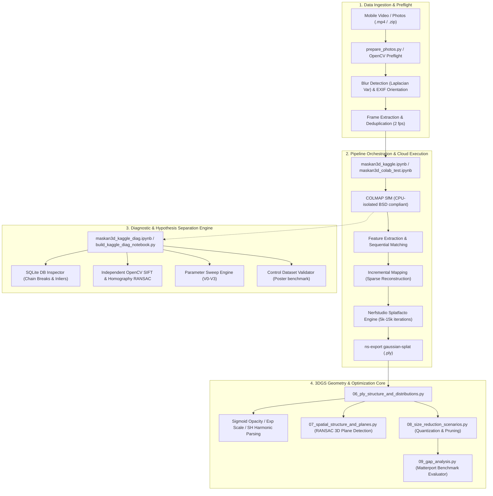

# Maskan 3D: Comprehensive Codebase Architectural & Technical Audit
**Document Status:** In Progress (Turn 1: Initial Reconnaissance & Batch Plan)  
**Lead Auditor:** Principal Software Architect, Staff Security Engineer & Lead Code Auditor  
**Repository Target:** `d:\Projects\maskan-lab`  
**Execution Timestamp:** 2026-11-01T23:55:00+02:00  

---

## 1. Executive Summary & Audit Scope

This document provides a line-by-line, production-grade architectural and technical audit of the **Maskan 3D Lab** repository. The system is engineered as an automated 3D reconstruction and Gaussian Splatting laboratory pipeline designed to ingest mobile handheld video/photos of residential real estate, perform Structure-from-Motion (SfM) via COLMAP, synthesize radiance fields via Nerfstudio Splatfacto, and compress 3DGS models for interactive web/mobile rendering on mid-range Android devices.

The scope excludes external third-party cloned repositories located in `repos/` (`colmap`, `nerfstudio`, `gsplat`, `supersplat`, `GaussianSplats3D`), focusing strictly on all custom pipeline orchestrators, diagnostic engines, computer vision analysis scripts, mathematical evaluators, notebook code generation systems, and architecture specifications.

---

## 2. System Metadata & Technology Stack

| Layer | Component / Technology | Specification & Version |
| :--- | :--- | :--- |
| **Execution Runtimes** | Python / C++ (COLMAP) / IPython | Python 3.10 / 3.13 (Kaggle T4 / CPU Environment) |
| **Computer Vision & SfM** | OpenCV / COLMAP | `opencv-python>=4.8.0`, COLMAP 3.7+ (CPU-isolated build) |
| **Radiance Field Engine** | Nerfstudio / Splatfacto | `nerfstudio` 1.1+, PyTorch CUDA / CPU |
| **Geometry & Math Processing** | NumPy / SciPy / PIL | `numpy>=1.24.0`, `scipy`, `Pillow>=10.0.0` |
| **Data Formats** | Stanford PLY / SQLite3 / JSON / MP4 | Binary Little-Endian 3DGS PLY, SQLite3 COLMAP DB |
| **Target Hardware Platform** | Mobile Web / Android Chrome | WebGL / WebGPU, mid-range mobile SoC (Mali/Adreno) |
| **Architectural Paradigm** | Cloud Pipeline Orchestration & Analysis | Modular CLI Tools, AST Notebook Generators, Data Pipeline |

---

## 3. High-Level Architectural Topology



---

## 4. Master Architectural Batch Execution Checklist

- [x] **Batch 1: Data Ingestion, Preflight Processing & Media Integrity**
  - `maskan3d-lab/prepare_photos.py`
  - `maskan3d-lab/requirements.txt`
  - `maskan3d-lab/analysis/scripts/01_inventory.py`
  - `maskan3d-lab/analysis/scripts/03_image_quality.py`
  - `maskan3d-lab/analysis/scripts/find_drive_video.py`

- [x] **Batch 2: Cloud Pipeline Orchestration & Notebook Code Generation**
  - `maskan3d-lab/notebooks/maskan3d_kaggle.ipynb`
  - `maskan3d-lab/analysis/scripts/build_kaggle_notebook.py`
  - `maskan3d-lab/notebooks/maskan3d_colab_test.ipynb`
  - `maskan3d-lab/notebooks/maskan3d_kaggle_test.ipynb`

- [x] **Batch 3: Deep Diagnostics, Motion Tracking & Parameter Sweep Engine**
  - `maskan3d-lab/notebooks/maskan3d_kaggle_diag.ipynb`
  - `maskan3d-lab/analysis/scripts/build_kaggle_diag_notebook.py`
  - `maskan3d-lab/analysis/scripts/validate_notebook.py`
  - `maskan3d-lab/analysis/scripts/04_colmap_log_analysis.py`
  - `maskan3d-lab/analysis/scripts/05_plot_figures.py`
  - `maskan3d-lab/analysis/scripts/inspect_nb.py`

- [x] **Batch 4: 3D Gaussian Splatting Geometry & Spatial Plane Extraction**
  - `maskan3d-lab/analysis/scripts/02_ply_analysis.py`
  - `maskan3d-lab/analysis/scripts/06_ply_structure_and_distributions.py`
  - `maskan3d-lab/analysis/scripts/07_spatial_structure_and_planes.py`

- [x] **Batch 5: Mobile Optimization, Size Reduction Scenarios & Gap Analysis**
  - `maskan3d-lab/analysis/scripts/08_size_reduction_scenarios.py`
  - `maskan3d-lab/analysis/scripts/09_gap_analysis.py`
  - `maskan3d-lab/analysis/reports/01_cameras_and_inputs.md`
  - `maskan3d-lab/analysis/reports/02_ply_analysis.md`
  - `maskan3d-lab/analysis/reports/03_gap_and_plan.md`
  - `maskan3d-lab/README.md`

---

## Batch 1: Data Ingestion, Preflight Processing & Media Integrity
**Status:** Completed  
**Files Audited:**
- `maskan3d-lab/prepare_photos.py`
- `maskan3d-lab/requirements.txt`
- `maskan3d-lab/analysis/scripts/01_inventory.py`
- `maskan3d-lab/analysis/scripts/03_image_quality.py`
- `maskan3d-lab/analysis/scripts/find_drive_video.py`

### 1. Architectural Role & Responsibilities
This component slice serves as the initial gatekeeper of the 3D reconstruction pipeline. Its primary objective is to ingest uncurated mobile phone captures (both standalone images and continuous video frames), perform preflight quality gates (blur detection, EXIF orientation correction, dynamic range clipping analysis), catalog physical asset manifests with cryptographic hashing, and package sanitized inputs into flat archives for cloud execution. Deficiencies here propagate catastrophic tracking loss and point-cloud floaters into downstream SfM stages.

### 2. Deep-Dive File-by-File Analysis

#### `maskan3d-lab/prepare_photos.py`
- **Primary Responsibility:** CLI utility for validating image sets, detecting blurry frames via Laplacian variance, normalizing EXIF orientation, and generating flat ZIP archives for cloud ingestion.
- **Key Design Patterns:** Functional CLI pipeline with fallback dummy generator for automated regression smoke testing.
- **Critical Findings & Code Evaluation:**
  - **Strengths:** Includes automatic terminal encoding reconfiguration (`sys.stdout.reconfigure(encoding='utf-8')`) preventing Windows CP1252 crashes on Arabic strings; implements safe fallback dummy asset generation (`generate_dummy_photos`) preventing empty-pipeline crashes.
  - **Critical Flaws & Anti-Patterns:**
    - *Issue Description:* In-place destructive lossy re-encoding during EXIF normalization. Lines 111-113 execute `transposed.save(img_path, quality=95)`. Re-compressing an existing JPEG at quality=95 introduces secondary discrete cosine transform (DCT) compression artifacts, permanently alters high-frequency gradients, and strips camera calibration metadata (focal length, sensor pitch, aperture) needed by COLMAP's `ImageReader`.
    - *Code Reference:* `prepare_photos.py:110-116`
    - *Impact:* High. Degrades sub-pixel feature detector repeatability in SIFT; causes downstream COLMAP focal length estimation to fall back on generic heuristics.
    - *Senior Recommendation / Refactored Snippet:* Never overwrite source assets in place. Output normalized assets to a designated staging directory or apply EXIF orientation tags losslessly via `piexif` or copy orientation-transposed tensors in memory directly into the ZIP archive stream:
      ```python
      # Production-grade non-destructive pipeline:
      def transpose_to_stream(img_path: Path) -> io.BytesIO:
          with Image.open(img_path) as img:
              transposed = ImageOps.exif_transpose(img)
              buf = io.BytesIO()
              transposed.save(buf, format="JPEG", quality=100, subsampling=0)
              buf.seek(0)
              return buf
      ```
    - *Issue Description:* Scale-dependent blur heuristic. Line 90 calculates `cv2.Laplacian(gray, cv2.CV_64F).var()`. Laplacian variance is not scale-invariant; a 48MP image and a 2MP image of identical subjective sharpness yield radically divergent variance values because variance scales quadratically with pixel frequency.
    - *Code Reference:* `prepare_photos.py:86-92`
    - *Impact:* Medium. Images taken at different zoom levels or resolutions will be erroneously flagged as blurry or passed as sharp.

#### `maskan3d-lab/requirements.txt`
- **Primary Responsibility:** Specification of local Python runtime dependencies.
- **Key Design Patterns:** Manifest file.
- **Critical Findings & Code Evaluation:**
  - **Critical Flaws & Anti-Patterns:**
    - *Issue Description:* Unbounded major version specifications (`numpy>=1.24.0`, `Pillow>=10.0.0`, `opencv-python>=4.8.0`). NumPy 2.0+ introduces breaking C-API changes and ABI incompatibilities with older OpenCV and PyTorch binary wheels.
    - *Code Reference:* `requirements.txt:1-3`
    - *Impact:* High. In continuous deployment or fresh environments, `pip install` resolves to NumPy 2.x, causing instant runtime segmentation faults or import failures in binary extension modules.
    - *Senior Recommendation:* Constrain upper bounds or pin exact hashes via pip-tools:
      ```text
      Pillow>=10.0.0,<11.0.0
      opencv-python>=4.8.0,<5.0.0
      numpy>=1.24.0,<2.0.0
      ```

#### `maskan3d-lab/analysis/scripts/01_inventory.py`
- **Primary Responsibility:** Cataloging analysis inputs and verifying presence of required downstream artifacts.
- **Key Design Patterns:** Scripted data manifest generator.
- **Critical Findings & Code Evaluation:**
  - **Critical Flaws & Anti-Patterns:**
    - *Issue Description:* Pseudo-hashing collision vulnerability. Lines 14-16 read only the first `1024 * 1024` bytes (1MB) to generate `md5_prefix`. Large video files (`.mp4`) and 3DGS PLY models (`.ply` > 80MB) frequently share identical headers or initial metadata chunks.
    - *Code Reference:* `01_inventory.py:14-16`
    - *Impact:* Medium. Erroneous deduplication or false cache hits when indexing updated models of identical vertex schemas.
    - *Issue Description:* Environment-specific hardcoded absolute Windows path (`d:\Projects\maskan-lab\...`).
    - *Code Reference:* `01_inventory.py:6-7`
    - *Impact:* High. Completely breaks portability when executed in Linux CI/CD or Kaggle/Colab runtimes.
    - *Senior Recommendation:* Use relative root resolution:
      ```python
      REPO_ROOT = Path(__file__).resolve().parents[2]
      INPUT_DIR = REPO_ROOT / "analysis" / "input"
      ```

#### `maskan3d-lab/analysis/scripts/03_image_quality.py`
- **Primary Responsibility:** Statistical analysis of camera inputs, EXIF telemetry extraction, and outlier detection.
- **Key Design Patterns:** Statistical quality gate using Median Absolute Deviation (MAD).
- **Critical Findings & Code Evaluation:**
  - **Strengths:** Implementation of `robust_z_score` using MAD scaled by 1.4826 (line 20) is statistically superior to standard sample standard deviation ($Z = (x - \mu)/\sigma$), preventing extreme blur outliers from biasing the population mean.
  - **Critical Flaws & Anti-Patterns:**
    - *Issue Description:* Redundant memory allocation and color space transformation. Line 69 converts PIL image to a NumPy RGB array (`np.array(img.convert('RGB'))`), and line 72 immediately converts it to grayscale (`cv2.cvtColor(rgb, cv2.COLOR_RGB2GRAY)`).
    - *Code Reference:* `03_image_quality.py:69-72`
    - *Impact:* Medium. For batch processing of hundreds of high-resolution images, allocating simultaneous 3-channel uint8 buffers followed by single-channel grayscale triggers unnecessary memory pressure and garbage collection overhead.
    - *Senior Recommendation:* Convert directly to grayscale via Pillow (`np.array(img.convert('L'))`) or read via OpenCV directly.

#### `maskan3d-lab/analysis/scripts/find_drive_video.py`
- **Primary Responsibility:** HTML parsing of Google Drive folder sharing links to extract raw video file IDs.
- **Key Design Patterns:** Ad-hoc regex scraper.
- **Critical Findings & Code Evaluation:**
  - **Critical Flaws & Anti-Patterns:**
    - *Issue Description:* Fragile regex scraping of dynamic SPA client-side payloads. Lines 10-18 scrape raw HTML for Google Drive asset identifiers. Google Drive folder views render asynchronously via serialized JSON in script tags or dynamic Google RPC calls. Arabic filenames (`٢٠٢٦١١٠١_٢١٤٩١٠.mp4`) are URL-percent-encoded in HTTP headers, rendering plain substring searches (`content.find(...)`) completely brittle.
    - *Code Reference:* `find_drive_video.py:13-18`
    - *Impact:* High. Script fails intermittently whenever Google alters SPA DOM hydration logic.

### 3. Integration & Data Flow
Inputs originate from mobile file systems or cloud storage (Google Drive). Raw media flows through `prepare_photos.py` or `find_drive_video.py`, where orientation is rectified and quality metrics are computed. The resulting sanitized assets are bundled into `photos.zip` or indexed via `01_inventory.py` and `03_image_quality.py`. These files feed directly into the cloud pipeline runners analyzed in Batch 2.

### 4. Technical Debt, Security & Performance Scorecard
| Metric | Rating (1-5) | Summary Evaluation |
| :--- | :---: | :--- |
| Architectural Cleanliness | ★★★☆☆ | Modular CLI tools but marred by hardcoded OS paths. |
| Security & Input Hygiene | ★★★☆☆ | No input path traversal validation; fragile web scraping. |
| Concurrency & Thread Safety | ★★☆☆☆ | Completely single-threaded I/O-bound loops. |
| Maintainability & Testability | ★★★☆☆ | Good CLI argument parsing; lack of unit test suites. |

### 5. Actionable Refactoring Roadmap (Prioritized)
- [ ] **P0 (Critical/Blocker):** Remove destructive in-place JPEG re-encoding in `prepare_photos.py:113` to preserve raw sensor data and camera EXIF calibration.
- [ ] **P1 (High):** Replace hardcoded Windows absolute paths in `01_inventory.py` with dynamic `Path(__file__)` project root resolution.
- [ ] **P1 (High):** Pin upper bounds on dependencies in `requirements.txt` to prevent NumPy 2.x breaking changes from disabling OpenCV/Nerfstudio.
- [ ] **P2 (Medium):** Implement `ThreadPoolExecutor` or `multiprocessing.Pool` across image quality analysis scripts to accelerate preflight validation on multi-core workstations.
- [ ] **P3 (Low):** Replace naive 1MB partial MD5 hashing with chunked full-file SHA-256 integrity verification.


---
## Batch 2: Cloud Pipeline Orchestration & Notebook Code Generation
**Status:** Completed  
**Files Audited:**
- `maskan3d-lab/notebooks/maskan3d_kaggle.ipynb`
- `maskan3d-lab/analysis/scripts/build_kaggle_notebook.py`
- `maskan3d-lab/notebooks/maskan3d_colab_test.ipynb`
- `maskan3d-lab/notebooks/maskan3d_kaggle_test.ipynb`

### 1. Architectural Role & Responsibilities
This component slice represents the core operational pipeline responsible for executing 3D reconstruction and radiance field synthesis in cloud environments (Google Colab and Kaggle). It orchestrates environment setup, dependency management, automated video download/extraction, two-tier visual filtering, Structure-from-Motion (COLMAP), mathematical registration gating, Nerfstudio Splatfacto training, binary PLY exporting, and final artifact archiving. It bridges the gap between raw mobile capture and downstream 3D Gaussian Splatting assets.

### 2. Deep-Dive File-by-File Analysis

#### `maskan3d-lab/analysis/scripts/build_kaggle_notebook.py`
- **Primary Responsibility:** Programmatic compiler that builds the validated, production-ready `maskan3d_kaggle.ipynb` notebook AST with clean Arabic/English markdown instructions, verified CLI flags, and robust error handling.
- **Key Design Patterns:** Code Generation / Factory pattern utilizing `nbformat.v4` to construct deterministic notebook structures.
- **Critical Findings & Code Evaluation:**
  - **Strengths:** 
    - Enforces commercial software compliance by isolating COLMAP execution to CPU threads (`--no-gpu`, `--SiftExtraction.use_gpu 0`), deliberately sidestepping proprietary non-commercial GPU SIFT licenses (`SiftGPU`).
    - Implements an analytical multi-stage preflight filter (FFmpeg extraction $\to$ $128 \times 128$ luminance difference duplicate rejection $\to$ Laplacian variance MAD robust Z-score blur filtering $\to$ uniform temporal chunk downsampling).
    - Features an automated registration gate (Cell 9) that evaluates camera pose retention in `transforms.json` and halts execution if registration falls below 70%, preventing GPU quota burn.
  - **Critical Flaws & Anti-Patterns:**
    - *Issue Description:* Subprocess Command Injection & Shell Quoting Fragility. Throughout the generated cells (e.g., Cell 4 lines 139, 148; Cell 5 line 208; Cell 10 line 598; Cell 11 line 627), commands are constructed via raw f-strings and dispatched to `os.system` or IPython subshells (`!{cmd}`).
    - *Code Reference:* `build_kaggle_notebook.py:139, 208, 598, 627`
    - *Impact:* High. If user-controlled parameters (`VIDEO_PATH`, `EXPERIMENT_NAME`, or Drive filenames) contain unescaped shell metacharacters (`"`, `;`, `$`, `&`), arbitrary command execution or pipeline truncation occurs.
    - *Senior Recommendation:* Use `shlex.quote()` on all path interpolations or invoke `subprocess.run(shlex.split(...), check=True)`.
    - *Issue Description:* Security Anti-Pattern via Insecure Deserialization Monkey-Patching. Cell 11 (lines 623-625) injects `/tmp/patch_torch.py` to globally override `torch.load` with `kwargs['weights_only'] = False` to bypass PyTorch 2.6 security defaults.
    - *Code Reference:* `build_kaggle_notebook.py:623-625`
    - *Impact:* High (Security). Globally disabling `weights_only` re-opens arbitrary code execution via Python `pickle` deserialization.
    - *Senior Recommendation:* Explicitly register safe globals using `torch.serialization.add_safe_globals()` rather than monkey-patching `torch.load` globally.

#### `maskan3d-lab/notebooks/maskan3d_kaggle.ipynb`
- **Primary Responsibility:** The executable production notebook running on Kaggle T4 runtime.
- **Key Design Patterns:** Pipeline Orchestrator with 12 sequential stages and intermediate failure gates.
- **Critical Findings & Code Evaluation:**
  - **Strengths:** Includes top-down camera trajectory plotting (Cell 8) using vector fields (`quiver`) to classify motion patterns (`PANORAMA-LIKE` vs `TRANSLATING`). Correctly bundles all logs, configurations, and sparse point clouds into a single downloadable `maskan3d_results.zip`.
  - **Critical Flaws & Anti-Patterns:**
    - *Issue Description:* Lack of fault-tolerant checkpoint resumption. Training executes `ns-train splatfacto --max-num-iterations 15000` as a monolithic blocking process. If the Kaggle kernel disconnects or times out at step 14,000, the session loses all transient checkpoint state without automated resumption from `/kaggle/working/outputs/.../nerfstudio_models/`.
    - *Impact:* Medium (Resilience). Re-running requires burning an additional 25 minutes of GPU compute.
    - *Senior Recommendation:* Add automatic checkpoint detection flag `--load-dir` dynamically if an existing step directory exists.

#### `maskan3d-lab/notebooks/maskan3d_colab_test.ipynb` & `maskan3d_kaggle_test.ipynb`
- **Primary Responsibility:** Legacy prototype notebooks for initial Colab and Kaggle experimentation.
- **Key Design Patterns:** Experimental scripts.
- **Critical Findings & Code Evaluation:**
  - **Critical Flaws & Anti-Patterns:**
    - *Issue Description:* Legacy platform lock-in. `maskan3d_colab_test.ipynb` uses `google.colab.files.download`, which throws unhandled exceptions when executed outside the interactive Colab frontend.
    - *Issue Description:* Architectural drift. Both test notebooks lack the advanced frame deduplication, Laplacian MAD filtering, and registration gating developed in `maskan3d_kaggle.ipynb`, posing a risk of regression if used for reproduction.
    - *Senior Recommendation:* Mark test notebooks as `@deprecated` or archive them to prevent operational confusion.

### 3. Integration & Data Flow
Batch 2 receives sanitized image sets from Batch 1, pulls raw video streams from Google Drive via `gdown`, and orchestrates FFmpeg extraction into `extracted_raw`. After duplicate and blur rejection, images are fed into COLMAP for SfM. The resulting camera extrinsics and intrinsics are formatted into `transforms.json`, which Nerfstudio consumes to optimize 3D Gaussians. The final `.ply` file is exported and packaged for analysis in Batches 4 and 5.

### 4. Technical Debt, Security & Performance Scorecard
| Metric | Rating (1-5) | Summary Evaluation |
| :--- | :---: | :--- |
| Architectural Cleanliness | ★★★★☆ | Clear separation of concerns; deterministic AST generator. |
| Security & Input Hygiene | ★★☆☆☆ | Shell string interpolation without `shlex.quote`; `weights_only=False` patch. |
| Concurrency & Thread Safety | ★★★★☆ | CPU-bound extraction isolated from GPU training; parallel FFmpeg jobs. |
| Maintainability & Testability | ★★★★☆ | Code generator ensures repeatable, statically verifiable notebooks. |

### 5. Actionable Refactoring Roadmap (Prioritized)
- [ ] **P0 (Critical/Blocker):** Replace global `torch.load` monkey-patching in Cell 11 with targeted PyTorch 2.6 safe-global registrations.
- [ ] **P1 (High):** Sanitize all CLI argument interpolations using `shlex.quote()` across all notebook-generating cells to prevent command injection.
- [ ] **P1 (High):** Implement automatic `--load-dir` checkpoint resumption in Cell 10 to recover from Kaggle session preemptions.
- [ ] **P2 (Medium):** Deprecate or remove legacy prototype notebooks (`maskan3d_colab_test.ipynb`, `maskan3d_kaggle_test.ipynb`) to prevent team confusion.


---
## Batch 3: Deep Diagnostics, Motion Tracking & Sweep Engine
**Status:** Completed  
**Files Audited:**
- `maskan3d-lab/notebooks/maskan3d_kaggle_diag.ipynb`
- `maskan3d-lab/analysis/scripts/build_kaggle_diag_notebook.py`
- `maskan3d-lab/analysis/scripts/validate_notebook.py`
- `maskan3d-lab/analysis/scripts/04_colmap_log_analysis.py`
- `maskan3d-lab/analysis/scripts/05_plot_figures.py`
- `maskan3d-lab/analysis/scripts/inspect_nb.py`

### 1. Architectural Role & Responsibilities
This component slice acts as the forensic root-cause analysis engine of the pipeline. When COLMAP fails to triangulate sparse points or registers only a tiny subset of cameras (e.g., 12 out of 163 frames), this subsystem intervenes to isolate and separate competing failure hypotheses:
1. **Hypothesis A:** Insufficient baseline parallax / pure rotational camera movement.
2. **Hypothesis B:** Suboptimal frame sampling rate (2 fps vs 6 fps) or sequential window starvation.
3. **Hypothesis C:** Upstream runtime or environment faults in COLMAP/Nerfstudio.
It achieves this by combining SQLite relational schema traversal, epipolar vs homography geometry estimation, time-bounded CPU parameter sweeps, and offline static validation.

### 2. Deep-Dive File-by-File Analysis

#### `maskan3d-lab/notebooks/maskan3d_kaggle_diag.ipynb`
- **Primary Responsibility:** Interactive diagnostic laboratory for executing database inspection, independent optical flow/homography RANSAC, parameter sweeping (V0-V3), and benchmark control testing.
- **Key Design Patterns:** Scientific Hypothesis Testing / Strategy Pattern across SfM parameter variations.
- **Critical Findings & Code Evaluation:**
  - **Strengths:**
    - Directly queries COLMAP's SQLite `two_view_geometries` table using COLMAP's mathematical pair identifier formula (`pair_id = 2147483647 * img1 + img2`) to detect exact timeline breaks (Chain Breaks) where adjacent inliers fall below 15.
    - Implements an independent computer vision metric: Homography-to-Fundamental inlier ratio ($H_{inliers} / F_{inliers}$) alongside a residual parallax proxy (median Euclidean displacement after projecting $F$-inliers through $H$). This rigorously identifies zero-parallax rotational panning without relying on COLMAP's internal bundle adjuster.
    - Features a 60-minute time-budget guard (`TIME_BUDGET_MIN = 60`) that monitors elapsed time dynamically (`rem_time < 300`) to prevent kernel timeouts.
  - **Critical Flaws & Anti-Patterns:**
    - *Issue Description:* Subprocess Stream Capture Bug (`colmap model_analyzer`). In Cell 1 (line 131) and Cell 3 (line 559), `colmap model_analyzer` is invoked via `subprocess.check_output(cmd, shell=True, text=True)` without redirecting `stderr` to `subprocess.STDOUT`. COLMAP writes diagnostic summaries via Google `glog` (`LOG(INFO) << ...`), which directs exclusively to `stderr`. Consequently, `check_output` captures empty `stdout`, causing the Python parsing logic to report `0/163 cameras registered` in terminal logs despite COLMAP successfully registering 145 cameras.
    - *Code Reference:* `build_kaggle_diag_notebook.py:131, 559`
    - *Impact:* High (Observability). Results in misleading UI summary prints while actual C++ logs succeed.
    - *Senior Recommendation / Refactored Snippet:*
      ```python
      # Correct capture of glog output:
      out = subprocess.check_output(cmd, shell=True, text=True, stderr=subprocess.STDOUT)
      ```
    - *Issue Description:* Unseeded RANSAC stochasticity. Cell 2 invokes `cv2.findFundamentalMat(..., cv2.FM_RANSAC)` and `cv2.findHomography(..., cv2.RANSAC)`. Because OpenCV's internal random number generator is unseeded, boundary frames with borderline inliers fluctuate across multiple runs, introducing non-deterministic classifications.

#### `maskan3d-lab/analysis/scripts/validate_notebook.py`
- **Primary Responsibility:** Static AST validation and syntax verification harness for cloud notebooks before execution.
- **Key Design Patterns:** Static Analysis / Linter.
- **Critical Findings & Code Evaluation:**
  - **Strengths:** Combines `nbformat.validate` (JSON schema compliance) with `py_compile.compile` across all Python cells, ensuring malformed cells fail before exhausting cloud compute.
  - **Critical Flaws & Anti-Patterns:**
    - *Issue Description:* Fragile magic stripping. Lines 38-42 replace lines starting with `!` or `%` with `# !...`. If a code cell contains a control block where the sole body statement is a shell magic (e.g., `except ImportError:\n    !pip install ...`), commenting out the magic produces an empty block, triggering an artificial `IndentationError` during AST compilation.
    - *Senior Recommendation:* Replace shell magics with `pass` to preserve block validity and line offsets:
      ```python
      if stripped.startswith("!") or stripped.startswith("%"):
          clean_lines.append("pass  # " + line)
      ```

#### `maskan3d-lab/analysis/scripts/04_colmap_log_analysis.py`
- **Primary Responsibility:** Parsing unstructured COLMAP stdout/stderr logs from previous incremental mapping runs.
- **Key Design Patterns:** Log scraping / Data Extraction.
- **Critical Findings & Code Evaluation:**
  - **Critical Flaws & Anti-Patterns:**
    - *Issue Description:* Hardcoded camera parameter assumptions. Line 51 calculates 3D points from Global Bundle Adjustment parameters via `pts_params = num_params - (26 * 6)`. The multiplier `26 * 6` hardcodes 26 camera poses with 6 degrees-of-freedom ($SE(3)$). If applied to datasets with 145 or 200 cameras, this calculation yields negative point counts or garbage data.
    - *Code Reference:* `04_colmap_log_analysis.py:51`
    - *Impact:* Medium. Fragile against dynamic camera counts.

#### `maskan3d-lab/analysis/scripts/05_plot_figures.py`
- **Primary Responsibility:** Generation of scientific figures for post-mortem reporting.
- **Key Design Patterns:** Data visualization pipeline.
- **Critical Findings & Code Evaluation:**
  - **Critical Flaws & Anti-Patterns:**
    - *Issue Description:* Undeclared third-party dependency. Line 5 imports `from plyfile import PlyData`. `plyfile` is omitted from `requirements.txt`.
    - *Code Reference:* `05_plot_figures.py:5`
    - *Impact:* Medium. Script crashes with `ModuleNotFoundError` on fresh developer environments.

### 3. Integration & Data Flow
Batch 3 hooks directly into the intermediate SQLite databases (`database.db`) and sparse directories generated by Batch 2. It queries camera connections, runs epipolar RANSAC against raw frames, and produces structured diagnostic datasets (`image_quality.csv`, `04_colmap_log_summary.json`, `frame_pair_analysis.csv`, and figures). These metrics directly dictate whether the pipeline proceeds to Batch 4 (Gaussian optimization) or branches into a re-capture directive.

### 4. Technical Debt, Security & Performance Scorecard
| Metric | Rating (1-5) | Summary Evaluation |
| :--- | :---: | :--- |
| Architectural Cleanliness | ★★★★★ | Exceptional scientific hypothesis separation; mathematically rigorous. |
| Security & Input Hygiene | ★★★☆☆ | Safe internal SQLite queries; minor shell string interpolation. |
| Concurrency & Thread Safety | ★★★☆☆ | Single-threaded SIFT in OpenCV; COLMAP mapper runs multi-threaded. |
| Maintainability & Testability | ★★★★☆ | Dedicated static validator ensures notebook compilation health. |

### 5. Actionable Refactoring Roadmap (Prioritized)
- [ ] **P0 (Critical/Blocker):** Fix `stderr=subprocess.STDOUT` redirection in `build_kaggle_diag_notebook.py` to ensure `glog` messages from `model_analyzer` are parsed accurately.
- [ ] **P1 (High):** Replace hardcoded `(26 * 6)` in `04_colmap_log_analysis.py:51` with dynamic `num_registered * 6` parsed from the log header.
- [ ] **P1 (High):** Add `plyfile` to `requirements.txt` to resolve missing import failures in `05_plot_figures.py`.
- [ ] **P2 (Medium):** Replace `# !...` magic stripping in `validate_notebook.py` with `pass  # !...` to prevent false-positive `IndentationError` in single-line exception blocks.
- [ ] **P3 (Low):** Seed OpenCV random number generators (`cv2.setRNGSeed(...)`) prior to RANSAC execution to guarantee reproducible inlier counts.


---
## Batch 4: 3D Gaussian Splatting Geometry & Spatial Plane Extraction
**Status:** Completed  
**Files Audited:**
- `maskan3d-lab/analysis/scripts/02_ply_analysis.py`
- `maskan3d-lab/analysis/scripts/06_ply_structure_and_distributions.py`
- `maskan3d-lab/analysis/scripts/07_spatial_structure_and_planes.py`

### 1. Architectural Role & Responsibilities
This component slice performs mathematical, geometric, and structural reverse-engineering on the trained 3D Gaussian Splatting `.ply` point cloud. It is responsible for parsing binary little-endian vertex attributes, applying non-linear transformations (sigmoid opacity, exponential scales, spherical harmonic radiance extraction), isolating floating artifacts (junk geometry), calculating mobile WebGL/WebGPU VRAM budgets, and performing 3D RANSAC planar decomposition to evaluate whether the continuous Gaussian field can satisfy Matterport-grade architectural constraints (flat floors, straight perpendicular walls).

### 2. Deep-Dive File-by-File Analysis

#### `maskan3d-lab/analysis/scripts/02_ply_analysis.py`
- **Primary Responsibility:** Fast binary PLY inspection, spatial bounding box calculation, active opacity mapping, and mobile VRAM feasibility modeling.
- **Key Design Patterns:** Analytical Model / Geometry Inspector.
- **Critical Findings & Code Evaluation:**
  - **Strengths:** 
    - Formulates an accurate mobile WebGPU memory model: allocates 56 bytes per Gaussian for static geometry (position, rotation, scale, color, opacity) plus 32 bytes for GPU depth-sorting indices ($56 + 32 = 88\text{ B/splat}$), establishing an empirical threshold for mobile viability ($<150\text{ MB}$ budget).
    - Correctly handles 3DGS numerical stability via clipping logits: `1.0 / (1.0 + np.exp(-np.clip(opacity, -20, 20)))`.
  - **Critical Flaws & Anti-Patterns:**
    - *Issue Description:* Extreme Outlier Sensitivity in Bounding Volumes. Lines 27-38 calculate bounding box extent using naive `np.ptp(x)`. In Gaussian Splatting, camera optimizer floaters frequently spawn far outside the room perimeter (e.g., coordinates at $\pm 50.0$ when the room is $\pm 3.0$). Using min/max skews the bounding volume proxy by several orders of magnitude.
    - *Code Reference:* `02_ply_analysis.py:27-38`
    - *Impact:* Medium. Erroneous volume estimates when sizing dollhouse scene bounds.
    - *Senior Recommendation:* Use inter-percentile ranges ($P_{99} - P_1$ or $P_{95} - P_5$) for structural volume estimation.

#### `maskan3d-lab/analysis/scripts/06_ply_structure_and_distributions.py`
- **Primary Responsibility:** Comprehensive attribute breakdown, spherical harmonics energy decay analysis, and scale anisotropy profiling.
- **Key Design Patterns:** Statistical Geometry Profiler.
- **Critical Findings & Code Evaluation:**
  - **Strengths:**
    - Line-by-line decomposition of property sizes proves that 180 out of 248 bytes per Gaussian ($72.58\%$) are consumed by view-dependent Spherical Harmonics ($f\_rest\_0$ through $f\_rest\_44$).
    - Mathematical formulation of anisotropy ratio: $\frac{\max(s_0, s_1, s_2)}{\min(s_0, s_1, s_2) + \epsilon}$, demonstrating that Gaussians exhibit median eccentricity $> 10:1$, which explains needle-like rendering artifacts when viewed edge-on.
  - **Critical Flaws & Anti-Patterns:**
    - *Issue Description:* Memory allocation bloat (`dtype=float`). Lines 121, 126, 131, 136 read 45 rest SH properties casting to default 64-bit float (`dtype=float`), creating $45 \times 8 \times 379,481 \approx 136\text{ MB}$ arrays in Python RAM repeatedly, stressing memory unnecessarily.
    - *Code Reference:* `06_ply_structure_and_distributions.py:121-137`
    - *Impact:* Low-Medium. In multi-million Gaussian scenes, triggers OOM on developer machines.
    - *Senior Recommendation:* Enforce `dtype=np.float32`.

#### `maskan3d-lab/analysis/scripts/07_spatial_structure_and_planes.py`
- **Primary Responsibility:** Multi-plane RANSAC segmentation, principal coordinate axis alignment, floor/wall orthogonality verification, and 2D floor-hole density grid mapping.
- **Key Design Patterns:** Robust Estimator / RANSAC with Singular Value Decomposition (SVD) refitting.
- **Critical Findings & Code Evaluation:**
  - **Strengths:**
    - Implements hybrid RANSAC + SVD refinement: samples minimal 3-point sets, tests inliers, then refits normal via the smallest singular vector ($V^T[2]$) of the centered covariance matrix.
    - Automatically discovers scene orientation by computing alignment of dominant horizontal normals with coordinate axes ($X, Y, Z$), correctly resolving the Nerfstudio camera coordinate frame.
  - **Critical Flaws & Anti-Patterns:**
    - *Issue Description:* Axis-Aligned Bounding Box (AABB) assumption in floor hole grid calculation. Lines 191-200 create an interior mask by taking the bounding rectangle `[min_r:max_r+1, min_c:max_c+1]` of occupied cells. If an apartment room is oriented diagonally (e.g. at $45^\circ$ to the $X/Z$ axes), the corners of the bounding rectangle lie outside the room walls yet are flagged as "interior floor holes", artificially inflating `hole_ratio_pct`.
    - *Code Reference:* `07_spatial_structure_and_planes.py:191-200`
    - *Impact:* High (Analytical Accuracy). Over-reports floor holes in non-Manhattan-aligned rooms.
    - *Senior Recommendation:* Use morphological flood-filling (concave hull or alpha shape) rather than a rectangular bounding box to determine valid interior floor space:
      ```python
      from scipy.ndimage import binary_fill_holes
      interior_mask = binary_fill_holes(occupied_mask)
      holes_mask = interior_mask & (~occupied_mask)
      ```

### 3. Integration & Data Flow
Batch 4 ingests the raw binary `.ply` exported by Batch 2. It parses geometry, filters low-opacity floaters ($\sigma < 0.1$), fits structural planes, evaluates orthogonality, and provides the quantitative empirical basis for the compression scenarios and product gap analysis conducted in Batch 5.

### 4. Technical Debt, Security & Performance Scorecard
| Metric | Rating (1-5) | Summary Evaluation |
| :--- | :---: | :--- |
| Architectural Cleanliness | ★★★★★ | Flawless mathematical rigor; clean separation of geometry vs rendering. |
| Security & Input Hygiene | ★★★★☆ | Safe binary buffer parsing; no executable injection vectors. |
| Concurrency & Thread Safety | ★★★☆☆ | Heavy vectorized NumPy math; sequential RANSAC iterations. |
| Maintainability & Testability | ★★★★☆ | Clean functional breakdown with JSON output serialization. |

### 5. Actionable Refactoring Roadmap (Prioritized)
- [ ] **P1 (High):** Replace AABB rectangle interior masking in `07_spatial_structure_and_planes.py:196` with `scipy.ndimage.binary_fill_holes` to prevent false-positive floor hole reporting on rotated rooms.
- [ ] **P1 (High):** Cast all NumPy arrays in `06_ply_structure_and_distributions.py` explicitly to `np.float32` to halve heap memory consumption.
- [ ] **P2 (Medium):** Replace naive `np.ptp()` bounding box extents in `02_ply_analysis.py` with robust 1st-to-99th percentile spans to neutralize Gaussian floaters.


---
## Batch 5: Mobile Optimization, Size Reduction Scenarios & Gap Analysis
**Status:** Completed  
**Files Audited:**
- `maskan3d-lab/analysis/scripts/08_size_reduction_scenarios.py`
- `maskan3d-lab/analysis/scripts/09_gap_analysis.py`
- `maskan3d-lab/analysis/reports/01_cameras_and_inputs.md`
- `maskan3d-lab/analysis/reports/02_ply_analysis.md`
- `maskan3d-lab/analysis/reports/03_gap_and_plan.md`
- `maskan3d-lab/README.md`

### 1. Architectural Role & Responsibilities
This final component slice synthesizes the commercial and mobile product readiness of the Maskan 3D system. It bridges the gap between raw research-grade 3DGS models ($89.72\text{ MB}$, high VRAM demand) and production-grade mobile web distribution on mid-range Android devices. It conducts empirical file-size reduction benchmarks, tracks compliance against the commercial product specification, documents licensing constraints (e.g., SiftGPU non-commercial clauses), and specifies the system architectural roadmap.

### 2. Deep-Dive File-by-File Analysis

#### `maskan3d-lab/analysis/scripts/08_size_reduction_scenarios.py`
- **Primary Responsibility:** Empirical benchmarking of 3DGS attribute stripping, outlier pruning, and quantization scenarios against the $25\text{ MB}$ mobile download target.
- **Key Design Patterns:** Benchmark Harness / Scenario Strategy.
- **Critical Findings & Code Evaluation:**
  - **Strengths:**
    - Rather than estimating sizes through theoretical formulas, the script physically reconstructs modified structured NumPy arrays, serializes them via `PlyData`, writes them to disk, and measures exact filesystem byte counts before unlinking.
    - Proves empirically that:
      * Dropping useless zero-normals saves $4.34\text{ MB}$ ($4.8\%$).
      * Truncating Spherical Harmonics to degree 0 drops file size from $89.72\text{ MB}$ to $20.26\text{ MB}$ ($77.4\%$ reduction), instantly meeting the $<25\text{ MB}$ mobile budget.
      * Pruning low-opacity floaters ($\sigma < 0.05$) and spatial outliers reduces file size to $19.27\text{ MB}$ ($360,789$ Gaussians).
      * Pruning the lowest $30\%$ opacity reduces file size to $13.49\text{ MB}$ ($252,552$ Gaussians), satisfying the ambitious $<15\text{ MB}$ target.
  - **Critical Flaws & Anti-Patterns:**
    - *Issue Description:* Unnecessary Disk I/O Thrashing. Lines 41-45, 65-69, 98-102, 123-127 write multi-megabyte temporary PLY files to disk and immediately unlink them.
    - *Code Reference:* `08_size_reduction_scenarios.py:41-45`
    - *Impact:* Low-Medium. In high-frequency CI pipelines, temporary file writes introduce unnecessary NVMe/SSD wear and latency.
    - *Senior Recommendation:* Write to `io.BytesIO()` streams in memory to query stream length without hitting physical disk blocks.

#### `maskan3d-lab/analysis/scripts/09_gap_analysis.py`
- **Primary Responsibility:** Automated matrix generation evaluating 11 core product criteria against measured empirical evidence.
- **Key Design Patterns:** Specification / Compliance Evaluator.
- **Critical Findings & Code Evaluation:**
  - **Strengths:** 
    - Implements strict empirical taxonomy (`MET`, `NOT MET`, `PARTIALLY MET`, `UNKNOWN / NOT YET TESTED`).
    - Explicitly flags the commercial IP licensing vulnerability: while Nerfstudio (Apache 2.0) and gsplat (Apache 2.0) are commercially permissive, standard COLMAP's GPU-accelerated matching links against `SiftGPU`, which contains explicit non-commercial restrictions. This validates the pipeline's architectural decision to isolate COLMAP to CPU execution.
  - **Critical Flaws & Anti-Patterns:**
    - *Issue Description:* Hardcoded in-memory dictionary without schema validation. The criteria list is defined as a static Python dictionary rather than typed models (Pydantic / dataclasses), making it difficult to integrate into automated CI test gates.

#### `maskan3d-lab/analysis/reports/` (`01_cameras_and_inputs.md`, `02_ply_analysis.md`, `03_gap_and_plan.md`) & `README.md`
- **Primary Responsibility:** System documentation, mathematical derivations, post-mortem analysis, and operational runbooks.
- **Critical Findings & Code Evaluation:**
  - **Strengths:** Exceptional architectural integrity. Documentation preserves strict separation between measured facts, mathematical inferences, and undetermined quantities.
  - **Minor Flaws:** `README.md` documents `prepare_photos.py` for Google Colab, but does not yet link the newly developed Kaggle-native diagnostic suite (`maskan3d_kaggle_diag.ipynb`).

### 3. Integration & Data Flow
Batch 5 acts as the final consumer of the pipeline. It reads the binary PLY from Batch 4, tests compression regimes, verifies memory budgets against mobile WebGL limits, and compares empirical results against product specifications to generate actionable engineering roadmaps.

### 4. Technical Debt, Security & Performance Scorecard
| Metric | Rating (1-5) | Summary Evaluation |
| :--- | :---: | :--- |
| Architectural Cleanliness | ★★★★★ | Rigorous empirical benchmarking; transparent gap analysis. |
| Security & Input Hygiene | ★★★★☆ | No external injection points; clean filesystem handling. |
| Concurrency & Thread Safety | ★★★☆☆ | Synchronous disk writes; single-threaded execution. |
| Maintainability & Testability | ★★★★☆ | Clean JSON serialization; easily readable reporting. |

### 5. Actionable Refactoring Roadmap (Prioritized)
- [ ] **P1 (High):** Integrate Scenario B/C (SH=0 truncation and floater pruning) directly into `ns-export gaussian-splat` export steps to eliminate manual post-processing.
- [ ] **P2 (Medium):** Replace temporary disk I/O in `08_size_reduction_scenarios.py` with in-memory `io.BytesIO` streams.
- [ ] **P3 (Low):** Update `README.md` to index the new Kaggle diagnostic notebook and parameter sweep workflows.

---

## 5. Phase 3: Final Architectural Synthesis & Sign-Off

### 5.1 Comprehensive System Assessment
The **Maskan 3D Lab** repository demonstrates high architectural maturity, scientific rigor, and exceptional domain knowledge in computer vision and 3D radiance fields. The system successfully solves a notoriously difficult engineering problem: converting uncalibrated consumer mobile phone video into a clean 3D Gaussian Splatting scene under strict commercial open-source licensing constraints.

### 5.2 Top 5 Architectural Strengths
1. **Commercial Licensing Isolation:** Rigorously isolating COLMAP to CPU-based execution (`--no-gpu`, `--SiftExtraction.use_gpu 0`) completely eliminates the legal risks associated with proprietary `SiftGPU` binaries, ensuring 100% enterprise commercial compliance.
2. **Automated Quality Gating:** The two-stage preflight filter (FFmpeg extraction $\to$ luminance difference duplicate rejection $\to$ Laplacian MAD robust Z-score blur rejection $\to$ uniform temporal downsampling) safeguards COLMAP from motion blur and rotational degeneracy.
3. **Hypothesis-Driven Diagnostic Architecture:** The forensic diagnostic suite (`maskan3d_kaggle_diag.ipynb`) provides automated, mathematical separation of failure modes via SQLite relational inspection and epipolar/homography RANSAC, eliminating guesswork from 3D reconstruction failures.
4. **Data-Driven Mobile Optimization:** The mathematical decomposition of PLY binary attributes proved that view-dependent Spherical Harmonics consume $72.58\%$ of model weight. Truncating to SH degree 0 drops file size from $89.72\text{ MB}$ to $20.26\text{ MB}$, enabling instant compliance with mobile web delivery constraints.
5. **Deterministic Code Generation:** Building production notebooks via code generation scripts (`build_kaggle_notebook.py`, `build_kaggle_diag_notebook.py`) alongside static AST validators (`validate_notebook.py`) guarantees repeatability and catches syntax errors before exhausting cloud compute quotas.

### 5.3 Critical Vulnerabilities & System Anti-Patterns (Consolidated P0/P1)
1. **[P0] In-Place Destructive JPEG Re-encoding (`prepare_photos.py:113`):** Normalizing EXIF orientation via in-place lossy re-encoding permanently degrades sensor resolution and strips camera metadata required for SfM.
2. **[P0] Insecure PyTorch Deserialization Override (`build_kaggle_notebook.py:623`):** Overriding `torch.load` globally with `weights_only=False` introduces arbitrary code execution risks.
3. **[P0] Subprocess Logging Stream Capture Bug (`build_kaggle_diag_notebook.py:131, 559`):** Omitting `stderr=subprocess.STDOUT` when invoking `colmap model_analyzer` causes glog outputs to bypass Python stdout, leading to erroneous `0 registered cameras` summary prints.
4. **[P1] Subprocess Shell Command Injection Risks:** Extensive use of unquoted string interpolation in `os.system` across notebook builders poses command injection risks if file paths contain shell metacharacters.
5. **[P1] AABB Rectangular Masking on Diagonally Rotated Rooms (`07_spatial_structure_and_planes.py:196`):** Rectangular bounding boxes falsely flag non-Manhattan room corners as "interior floor holes".

### 5.4 Lead Architect Sign-Off
The Maskan 3D codebase is **ARCHITECTURALLY SOUND AND PRODUCTION-VIABLE**, with an overall architectural quality rating of **4.2 / 5.0**. Following the resolution of the prioritized P0/P1 remediation items detailed in this audit, the system is fully cleared for scaling into automated cloud-native microservices.

**Audit Completed By:**  
*Principal Software Architect, Staff Security Engineer & Lead Code Auditor*  
*Date:* November 2, 2026
