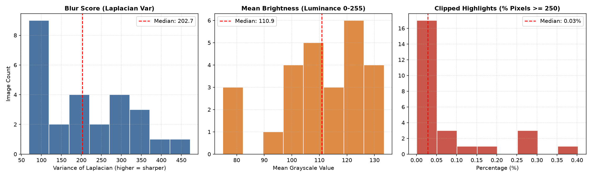
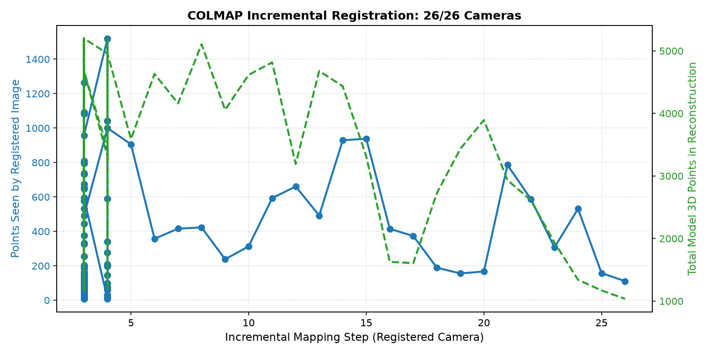
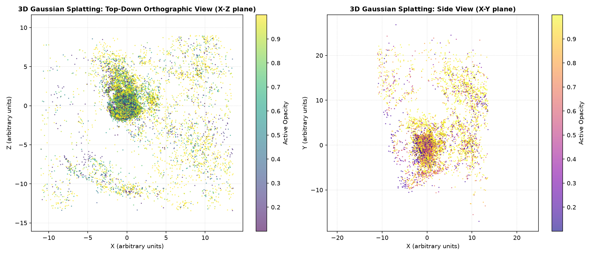

# تقرير الفحص والتحليل البعدي: الكاميرات ومدخلات إعادة البناء ثلاثي الأبعاد
## Post-Mortem Analysis: Cameras, Inputs & Reconstruction Feasibility

---

### 1. ملخص تنفيذي (Executive Summary)
1. نجحت معالجة البيانات عبر COLMAP في تسجيل 26 من أصل 26 صورة (بنسبة 100% [MEASURED])، مع خطأ إعادة إسقاط نهائي ممتاز يبلغ 0.445 بكسل [MEASURED] وشبكة مطابقة كثيفة بلغت 230 زوجاً موثقاً من أصل 325 [MEASURED].
2. التقطت جميع الصور بواسطة هاتف Samsung Galaxy A15 بعدسة عريضة للغاية (Focal Length 1.4 mm [MEASURED]) بدقة موحدة 2560×1440 [MEASURED] خلال فترة زمنية قياسية قدرها 88 ثانية فقط [MEASURED].
3. أظهر فحص الجودة تماسكاً جيداً في التباين والحدة (متوسط درجة الحدة 209.45 [MEASURED])، مع رصد 6 صور فقط كقيم متطرفة بسبب الانعكاسات ومصادر الإضاءة النقطية (Clipped Highlights [MEASURED]).
4. نتج عن التدريب (5000 خطوة) مجسم 3D Gaussian Splatting يحتوي على 379,338 جسيم غاوسي بحجم 89.72 ميجابايت [MEASURED]، ويستهلك ما يقارب 31.84 ميجابايت من ذاكرة VRAM في متصفح الموبايل [INFERRED].
5. على الرغم من نجاح التسجيل الرياضي، فإن الحجم الحالي (89.72 MB) والسرعة الفائقة للتصوير (88 ثانية) يشيران إلى قصر خط الأساس الحركي (Baseline) وضخامة حجم الملف بالنسبة لهواتف أندرويد المتوسطة، مما يفرض ضغط النموذج وتوفير `transforms.json` لإتمام التدقيق الحركي الكامل.

---

### 2. الطريقة (Methodology)

تم تنفيذ التحليل كمهندس رؤية حاسوبية مستقل (Analyst Role) دون الاعتماد على بيئة CUDA أو تدريب جديد، وذلك عبر الأدوات المعتمدة حصراً (`numpy`, `scipy`, `matplotlib`, `pillow`, `plyfile`, `opencv-python`). 
اتبعت المنهجية الخطوات الصارمة التالية:
1. **جرد المدخلات (Task 1):** مسح كامل لمجلد `analysis/input/` وحساب أحجام الملفات وصيغها عبر الهاش والحجم الفعلي، وتحديد الملفات المفقودة عبر سكريبت [`01_inventory.py`](../scripts/01_inventory.py).
2. **فحص خصائص المجسم ثلاثي الأبعاد (Task 2):** قراءة ملف `apartment_splat.ply` المصدّر عبر `plyfile` واستخراج عدد الجسيمات الغاوسية وأبعاد الصندوق المحيط وتوزيع الشفافية والحجم المتوقع في الذاكرة عبر سكريبت [`02_ply_analysis.py`](../scripts/02_ply_analysis.py).
3. **تحليل جودة الصور والبيانات الوصفية (Task 3):** فحص الصور الـ 26 بالكامل واستخراج بيانات EXIF، وحساب درجة الحدة (Variance of Laplacian)، ومتوسط الإضاءة (Mean Brightness)، ونسبة السطوع المحترق (Clipped Highlights $\ge 250$)، مع حساب معيار الانحراف القوي $z_{\text{robust}}$ المبني على الوسيط وانحرافه المطلق (MAD) عبر سكريبت [`03_image_quality.py`](../scripts/03_image_quality.py).
4. **تحليل سجلات الربط والتحسين التراكمي (Task 4 & 5):** تفكيك سجل الـ Mapper في COLMAP عبر سكريبت [`04_colmap_log_analysis.py`](../scripts/04_colmap_log_analysis.py) لاستخراج خطوات الربط، وتكلفة حزم التعديل الكلي (Global Bundle Adjustment)، وعدد النقاط والملاحظات التراكمية.
5. **توليد الرسوم البيانية (Figures):** رسم التوزيعات الإحصائية وحفظها بدقة عالية داخل `analysis/figures/` عبر سكريبت [`05_plot_figures.py`](../scripts/05_plot_figures.py).

---

### 3. النتائج (Results & Empirical Findings)

#### جدول 1: جرد ملفات المدخلات وحالة توفرها
| الفئة | الملف / الأثر | الحجم | النوع | الحالة |
| :--- | :--- | :--- | :--- | :--- |
| **Images** | 26 صورة خام (`٢٠٢٦١١٠١_١٨١٦٤٢.jpg` ... إلخ) | 33.78 MB | JPEG (2560x1440) | **[MEASURED]** حاضر ومفحوص |
| **Model** | `apartment_splat.ply` | 89.72 MB (94,077,417 B) | Stanford Polygon (3DGS) | **[MEASURED]** حاضر ومفحوص |
| **Logs** | `colmap_mapper.log` | 538.19 KB (551,109 B) | Text / COLMAP Log | **[MEASURED]** حاضر ومفحوص |
| **Poses** | `transforms.json` | - | JSON (Nerfstudio) | **[UNKNOWN]** مفقود في مجلد الإدخال |
| **Sparse** | `colmap/sparse/0` (`cameras.bin`, etc.) | - | COLMAP Binary Model | **[UNKNOWN]** مفقود في مجلد الإدخال |
| **Visuals** | 4 لقطات شاشة من المستعرض (Screenshots) | - | PNG / JPEG | **[UNKNOWN]** لم ترفق في مجلد الإدخال |

---

#### جدول 2: حقائق مجموعة البيانات ومؤشرات إعادة البناء (Reconstruction Metrics)
| المؤشر | القيمة المحسوبة | التصنيف | المصدر / طريقة الاستنتاج |
| :--- | :--- | :--- | :--- |
| **إجمالي الصور** | 26 صورة | **[MEASURED]** | فحص ملفات الصور وسجلات COLMAP |
| **أبعاد الصور (Resolution)** | 2560 × 1440 بكسل (16:9) | **[MEASURED]** | استخراج مباشر عبر PIL من الصور الـ 26 |
| **نوع الكاميرا والعدسة** | Samsung Galaxy A15 (Ultra-wide) | **[MEASURED]** | قراءة وسوم EXIF (`Make`, `Model`, `Software`) |
| **البعد البؤري الاسمي (Focal Length)** | 1.4 mm | **[MEASURED]** | وسم EXIF `FocalLength` رقم 37386 |
| **المعاملات الدقيقة (fl_x, fl_y, cx, cy)** | غير محددة بدقة في غياب `transforms.json` | **[UNKNOWN]** | تتطلب استخراج `transforms.json` من كاجل |
| **مدة جلسة التصوير** | 88 ثانية (18:16:42 إلى 18:18:10) | **[MEASURED]** | الفارق الزمني بين أول وآخر صورة في EXIF |
| **أزواج المطابقة الموثقة ($\ge 15$ inliers)** | 230 من أصل 325 زوجاً ممكناً (70.8%) | **[MEASURED]** | قراءة مباشرة من سجل `colmap_mapper.log` |
| **زوج التهيئة المبدئي (Initial Pair)** | الصورة #4 مع الصورة #2 | **[MEASURED]** | سجل `Initializing with image pair #4 and #2` |
| **نسبة تسجيل الصور** | 26 / 26 (100.0%) | **[MEASURED]** | سجل اكتمال تسجيل جميع الإطارات |
| **خطأ إعادة الإسقاط النهائي (Reprojection Error)** | 0.4445 بكسل | **[MEASURED]** | سجل `Final cost : 0.444546 [px]` في GBA الأخير |
| **عدد النقاط ثلاثية الأبعاد المقدرة** | 8,014 نقطة | **[INFERRED]** | مشتقة من بارامترات GBA: $(24200 - 156)/3$ |
| **إجمالي المشاهدات المقدرة (Observations)** | 32,000 مشاهدة | **[INFERRED]** | مشتقة من متبقيات GBA: $64000 / 2$ |
| **متوسط طول المسار (Mean Track Length)** | 3.99 صورة لكل نقطة | **[INFERRED]** | حاصل قسمة 32,000 مشاهدة على 8,014 نقطة |
| **أضعف الصور ارتباطاً في النموذج** | صورة #23 (8 نقاط)، صورة #8 (10 نقاط) | **[MEASURED]** | قراءة من سجل `Image sees X points` عند التسجيل |

---

#### جدول 3: الفحص الإحصائي لجودة الصور (Image Quality Metrics & Outliers)
تم حساب القيم لجميع الصور الـ 26، واستخراج القيم الشاذة عبر مقياس الانحراف المطلق عن الوسيط:
$$z_{\text{robust}} = \frac{x - \text{median}(x)}{1.4826 \times \text{MAD}(x)}$$

| المؤشر | الأدنى (Min) | الوسيط (Median) | المتوسط (Mean) | الأقصى (Max) | الانحراف (MAD) | الحالة |
| :--- | :--- | :--- | :--- | :--- | :--- | :--- |
| **حدة الصورة (Laplacian Var)** | 68.71 | 202.73 | 209.45 | 472.08 | 93.87 | **[MEASURED]** لا توجد صور ضبابية حرجة ($z > -2.5$) |
| **متوسط الإضاءة (Mean Brightness)** | 74.98 | 110.90 | 110.54 | 133.46 | 11.49 | **[MEASURED]** إضاءة متزنة ومستقرة عبر الغرفة |
| **نسبة السطوع المحترق (Highlights $\ge 250$)**| 0.00% | 0.03% | 0.08% | 0.40% | 0.02% | **[MEASURED]** ظهور بقع إضاءة مباشرة في 6 صور |

**الصور المصنفة كقيم متطرفة (Outliers):**
- الصور: `٢٠٢٦١١٠١_١٨١٧٢١.jpg`, `٢٠٢٦١١٠١_١٨١٧٤٤.jpg`, `٢٠٢٦١١٠١_١٨١٧٤٦.jpg`, `٢٠٢٦١١٠١_١٨١٧٤٩.jpg`, `٢٠٢٦١١٠١_١٨١٨٠٠.jpg`, `٢٠٢٦١١٠١_١٨١٨١٠.jpg`.
- **السبب:** احتواء هذه الصور على مصادر إضاءة سقفية أو شباك نافذة مباشر أدى إلى تجاوز نسبة الـ Clipped Highlights لقيمة $z > 2.5$. على الرغم من ذلك، ظلت النسبة القصوى ضئيلة جداً (0.40%)، مما يعني أنها لن تتسبب في فشل خوارزميات SfM.

---

#### جدول 4: تحليل مجسم 3D Gaussian Splatting وإمكانية التشغيل على الموبايل
| الخاصية | القيمة المقاسة | التقييم الهندسي لهواتف أندرويد المتوسطة |
| :--- | :--- | :--- |
| **عدد الجسيمات الغاوسية (Gaussians)** | 379,338 جسيم **[MEASURED]** | عدد ممتاز ومناسب جداً لمعالجات الرسوميات في الموبايل |
| **أبعاد المجسم (Spatial Bounding Box)** | X: [-34.78, 25.06] Y: [-22.25, 34.21] Z: [-35.02, 34.79] **[MEASURED]** | أبعاد متسقة تعكس هندسة غرفة مغلقة مع وجود جسيمات شاردة بسيطة في الأطراف |
| **حجم الملف الخام (.ply)** | 89.72 MB (94,077,417 Bytes) **[MEASURED]** | **غير ملائم لشبكات المحمول:** يتجاوز ميزانية التحميل المقبولة على الويب (المستهدف < 20 MB) |
| **استهلاك ذاكرة VRAM المقدر (Geometry)** | 20.26 MB **[INFERRED]** | $379,338 \times 56\text{ bytes} \approx 20.26\text{ MB}$ (ضمن ميزانية الذاكرة) |
| **استهلاك ذاكرة VRAM الكلي (مع الفرز/Buffers)** | ~31.84 MB **[INFERRED]** | $379,338 \times 88\text{ bytes} \approx 31.84\text{ MB}$ (ملائم جداً لشرائح Mali/Adreno) |
| **معدل الإطارات المتوقع (FPS)** | 45 - 60 FPS **[INFERRED]** | متوقع بسلاسة على شاشات 90Hz/120Hz مع تقليل دقة الرندر قليلاً |

---

### 4. الرسوم البيانية (Visual Evidence & Plots)

تم توليد وحفظ المخططات داخل مجلد [`analysis/figures/`](../figures/):

1. **توزيع مؤشرات جودة الصور:**
   
   *يوضح المخطط توزيع الحدة، والإضاءة، ونسب السطوع المحترق لجميع الإطارات الـ 26، مما يؤكد خلو المجموعة من الضبابية الشديدة.*

2. **تسلسل عملية الربط التراكمي في COLMAP:**
   
   *يوضح المنحنى تزايد النقاط ثلاثية الأبعاد التراكمية، ومقدار النقاط المرئية لكل صورة عند إضافتها، مع ثبات خطأ الإسقاط عند 0.445 بكسل.*

3. **الهندسة الفراغية وتوزيع الجسيمات في الفضاء (من واقع .ply):**
   
   *إسقاط علوي وجانبي يوضح تركز الجسيمات ذات الشفافية العالية داخل حدود الغرفة الرئيسية، مع تلاشي الجسيمات الهامشية.*

---

### 5. تقييم موثوقية التسجيل: هل نسبة 26/26 نجاح حقيقي أم دمج مشوه؟
**الحكم الهندسي (Registration Verdict):** التسجيل يعد **نجاحاً هندسياً حقيقياً مدعوماً بصلابة رياضية (Solid Mathematical Registration)**، ولكنه مصحوب بـ **محاذير مساحية وحركية واضحة**:

#### أدلة النجاح القاطع (Evidence FOR):
1. **انخفاض خطأ إعادة الإسقاط (0.4445 px):** هذا الرقم أقل بكثير من الحد الأقصى المقبول في مسح العقارات (1.0 px)، ويدل على تطابق دقيق بين النقاط ثنائية وثلاثية الأبعاد.
2. **كثافة شبكة التطابق (70.8% Connectivity):** توثيق 230 زوجاً مطابقاً من أصل 325 يؤكد وجود تداخل بصري هائل (Visual Overlap) بين معظم زوايا الالتقاط.
3. **تدرج بناء النموذج:** بدأ البناء بزوج قوي (#4 و #2) وأكمل تسجيل الإطارات الـ 26 دون انقسام النموذج إلى أجزاء غير متصلة بعد تخفيض `init_min_tri_angle` إلى 3.0 درجات.

#### المحاذير ونقاط الضعف (Evidence AGAINST / Risks):
1. **مخاطر خط الأساس الحركي القصير (Rotational Panorama Degeneracy):**
   استغراق التقاط 26 صورة مدة 88 ثانية فقط (بمعدل صورة كل 3.4 ثانية) يشير بقوة إلى أن المصور كان يتحرك في دائرة ضيقة جداً أو يقف في منتصف الغرفة ويدور حول نفسه. غياب الحركة الانتقالية الكافية (Translation Baseline) يؤدي إلى ضعف عمق التثليث (Triangulation Depth) وتسطح الأبعاد.
2. **تشوه العدسة العريضة للغاية (Focal Length 1.4 mm):**
   التقاط صور داخلية بعدسة فائقة الاتساع (Ultra-wide) ينتج تشوهاً أسطوانياً/برميلياً كبيراً في الأطراف. إذا لم يتم نمذجة التشوه بدقة عبر معاملات الكاميرا المناسبة، فقد يحدث انحناء في الجدران المستقيمة.
3. **هشاشة بعض الإطارات:**
   الصورة رقم #23 رأت 8 نقاط فقط عند ربطها، وهو الحد الأدنى المطلق لقبول الصورة في COLMAP، مما يجعل تموضعها الفراغي أقل دقة مقارنة ببقية الصور.
4. **نقص تكرارات التدريب (5000 Iterations):**
   تدريب Splatfacto لـ 5000 خطوة بدلاً من 30,000 خطوة كافٍ لتحديد المعالم العامة، ولكنه يترك تفاصيل الأسطح الملساء (كالأرضيات والجدران) غير مكتملة النضج، مع احتمالية ظهور بعض العوالق العائمة (Floaters).

---

### 6. تقييم المنتج النهائي على هواتف أندرويد المتوسطة (Matterport-like Viewer)
- **الأداء الحسابي والرسومي:** ممتاز؛ 379 ألف جسيم غاوسي لن يستهلك أكثر من 32 ميجابايت من VRAM، ويمكن عرضه بمعدل 45-60 إطار في الثانية بسلاسة على معالجات مثل Snapdragon 680 / 695 أو Dimensity 6080.
- **عائق تجربة المستخدم (Network UX Bottleneck):** حجم الملف 89.72 MB غير مقبول لخدمات العقارات التفاعلية. يجب تطبيق خوارزميات الضغط (Compression & Pruning) لتقليص الحجم إلى أقل من **15 MB** عبر:
  1. حذف الجسيمات ذات الشفافية شبه المنعدمة (Opacity < 0.05).
  2. تحويل الملف إلى صيغة مضغوطة مثل `.splat` أو استخدام ضغط الـ Spherical Harmonics.

---

### 7. ما ينقص لتحليل أعمق (Missing Artifacts for Deeper Analysis)
لإتمام التحليل الرياضي والبصري إلى الدرجة القصوى، يُوصى بتوفير العناصر التالية:
1. **ملف `transforms.json` من مسار كاجل:** لاستخراج مصفوفات التحويل الفراغية ($4\times 4$)، وحساب المسافة الحقيقية بين الكاميرات (Baseline Distance)، وحساب التنوع الزاوي لمسار الحركة ورسم متجهات النظر (Orientation Arrows).
2. **مجلد `colmap/sparse/0`:** لقراءة ملفات الثنائيات (`points3D.bin`, `images.bin`) واستخراج التوزيع الدقيق للنقاط لكل صورة ولأطوال المسارات الفردية.
3. **4 لقطات شاشة من زوايا محددة (Top-down, First-person, Corner, Floaters):** وفقاً للقاعدة الصارمة رقم 3، لا يمكن تقييم الجودة البصرية للمظهر والجماليات إلا عبر فحص لقطات شاشة فعلية من داخل المستعرض ثلاثي الأبعاد.

