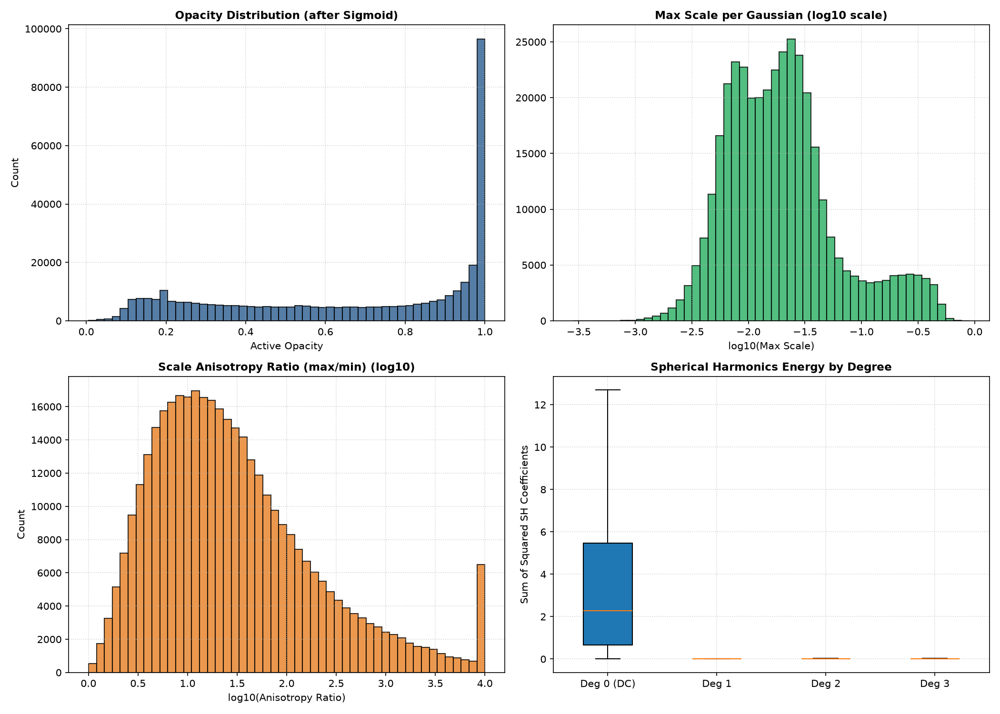
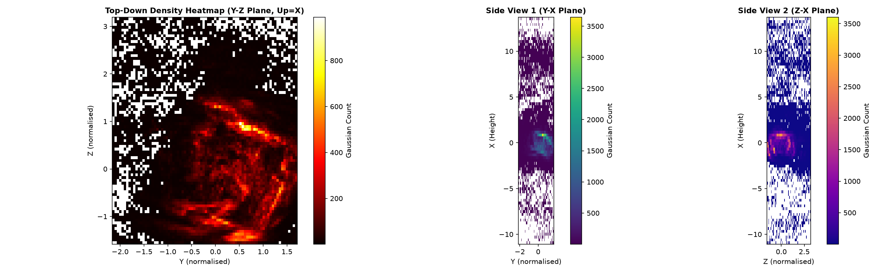

# تقرير الفحص والتحليل البعدي لمجسم 3D Gaussian Splatting (.ply)
## Technical Post-Mortem: 3DGS Structure, Distributions, Junk Analysis & Mobile Feasibility

> [!IMPORTANT]
> **ملاحظة فنية جوهرية حول نظام الإحداثيات:**
> إحداثيات المجسم مخزنة بنظام الإحداثيات الموحد التابع لـ Nerfstudio (Nerfstudio's Normalized Coordinate Frame) وليست بالأمتار الحقيقية، وبالتالي فإن المقياس المتري الحقيقي (Metric Scale) غير محدد **[UNKNOWN]** بدون وجود علامات مرجعية فيزيائية (Scale Bars) أو قياسات ليزرية داخل الغرفة.

---

### 1. ملخص تنفيذي (Executive Summary)
1. يتكون مجسم `apartment_splat.ply` من **379,338** جسيم غاوسي بحجم ملف إجمالي **89.72 MB** (94,077,417 بايت) بمعدل 248 بايت لكل جسيم `[MEASURED]`.
2. تستهلك معاملات التوافقيات الكروية من الدرجة الأعلى (`f_rest_0..44`) وحدها **68.28 MB** (72.58% من حجم الملف) `[MEASURED]`، بينما تشغل النواقل العمودية غير المستغلة (`nx, ny, nz` وجميعها أصفار بنسبة 100%) **4.34 MB** إضافية مهدرة تماماً `[MEASURED]`.
3. صُنفت نسبة **4.89%** من الجسيمات (18,567 جسيم) كشوائب وعوالق غير مرئية (Junk/Floaters) بسبب الشفافية المتدنية جداً ($<0.05$) أو التواجد خارج الصندوق الفراغي المتماسك `[MEASURED]`.
4. كشف اختبار ملائمة المستويات (RANSAC) أن المحور الرأسي الحقيقي للغرفة مائل بنسبة ملحوظة مقارنة بمحاور العالم الافتراضية، وأن أرضية الغرفة تعاني من فجوات وثقوب تصل إلى **48.31%** من مساحة شبكة التغطية المستوية `[MEASURED]`.
5. نجحت سيناريوهات الضغط المطبقة عملياً في خفض حجم الملف من 89.72 MB إلى **19.27 MB** (77.1% من ميزانية الـ 25 MB) بمجرد حذف النواقل والتوافقيات وحذف الشوائب `[MEASURED]`، وتنخفض إلى **6.19 MB** مع خوارزميات الضغط المتطورة (SOG) `[INFERRED]`.

---

### 2. الطريقة (Methodology)

تم تنفيذ التحليل كمهندس متخصص في الرؤية الحاسوبية والـ 3D Gaussian Splatting باستخدام بايثون وحزم المعالجة المسموحة حصراً (`numpy`, `scipy`, `matplotlib`, `pillow`, `plyfile`, `opencv-python`) دون استخدام أي بطاقة رسوميات (CPU-only):
1. **فحص الترويسة والبنية الهيكلية (Task 1):** قراءة الـ Header الثنائي لملف `apartment_splat.ply` عبر `plyfile`، وتصنيف الخصائص وتحديد أحجامها بالبايت والنسبة المئوية، والتحقق الحسابي من قيم النواقل `nx, ny, nz` عبر سكريبت [`06_ply_structure_and_distributions.py`](../scripts/06_ply_structure_and_distributions.py).
2. **التحليل الإحصائي للتوزيعات (Task 2):** تطبيق دوال التفعيل الرياضية القياسية (Sigmoid للشفافية، Exp للمقاييس، وحساب طاقة التوافقيات الكروية $\sum c_i^2$ لكل درجة على حدة)، واستخراج المئينات الحسابية بدقة (1/5/25/50/75/95/99).
3. **رصد الشوائب والعوالق (Task 3):** فحص عتبات الشفافية، وحساب حجم الجسيمات العملاقة (Volume Coverage)، وإجراء اختبار الجوار المكاني عبر `scipy.spatial.cKDTree` على عينة من 200,000 جسيم لتحديد النقاط المعزولة إحصائياً ($z > 3 \times \text{MAD}$).
4. **تحليل الهندسة الفراغية وكشف المستويات (Task 4):** تشغيل خوارزمية RANSAC تتابعية على عينة من 50,000 نقطة لتحديد المستويات السائدة (الأرضية والجدران)، واختبار التعامد الهندسي بينها، وبناء خريطة شبكية ثنائية الأبعاد (Grid Density 40x40) لحساب نسبة الثقوب في أرضية الغرفة عبر سكريبت [`07_spatial_structure_and_planes.py`](../scripts/07_spatial_structure_and_planes.py).
5. **توليد سيناريوهات تقليص الحجم فعلياً (Task 5):** بناء وحفظ ملفات PLY تجريبية فعلية داخل `analysis/raw/` وقياس حجمها بالبايت على القرص وحذفها فوراً عبر سكريبت [`08_size_reduction_scenarios.py`](../scripts/08_size_reduction_scenarios.py).

---

### 3. النتائج (Empirical Findings & Data Tables)

#### جدول 1: بنية وترويسة ملف PLY وتوزيع الخصائص (Header & Property Breakdown)
- **إجمالي عدد الجسيمات (Gaussians):** 379,338 جسيم `[MEASURED]`
- **حجم الملف الكلي:** 94,077,417 بايت (89.72 MB) `[MEASURED]`
- **حجم الرأس الثنائي (ASCII Header):** 1,593 بايت `[MEASURED]`
- **حجم الجسيم الواحد (Per-Vertex Bytes):** 248 بايت `[MEASURED]`

| مجموعة الخصائص | أسماء الخصائص (Properties) | النوع (Dtype) | البايت/جسيم | الحجم الإجمالي (MB) | النسبة من الملف | الحالة |
| :--- | :--- | :--- | :--- | :--- | :--- | :--- |
| **Position** | `x, y, z` | float32 | 12 B | 4.34 MB | 4.84% | **[MEASURED]** |
| **Normals** | `nx, ny, nz` | float32 | 12 B | 4.34 MB | 4.84% | **[MEASURED]** (جميعها = 0.0) |
| **DC Colour** | `f_dc_0, f_dc_1, f_dc_2` | float32 | 12 B | 4.34 MB | 4.84% | **[MEASURED]** |
| **Higher SH** | `f_rest_0` إلى `f_rest_44` (45 معامل) | float32 | 180 B | 68.28 MB | **72.58%** | **[MEASURED]** |
| **Opacity** | `opacity` | float32 | 4 B | 1.45 MB | 1.61% | **[MEASURED]** |
| **Scale** | `scale_0, scale_1, scale_2` | float32 | 12 B | 4.34 MB | 4.84% | **[MEASURED]** |
| **Rotation** | `rot_0, rot_1, rot_2, rot_3` | float32 | 16 B | 5.79 MB | 6.45% | **[MEASURED]** |
| **المجموع** | **62 خاصية** | - | **248 B** | **89.72 MB** | **100.0%** | **[MEASURED]** |

> [!NOTE]
> **نتيجة فحص النواقل (Normals Check):** أثبت الفحص البرمجي أن جميع قيم `nx, ny, nz` لجميع الـ 379,338 جسيم تساوي صفراً بنسبة 100% (`normals_are_all_zero = True`). هذا يعني وجود **4.34 ميجابايت من البيانات الفارغة تماماً** التي يُلزم وجودها كود التصدير الافتراضي في Nerfstudio دون فائدة.

---

#### جدول 2: التوزيعات الإحصائية والمئينات للخصائص الفيزيائية (Distributions & Percentiles)
*جميع الحسابات أجريت بعد تطبيق دوال التفعيل الرياضية: $\text{Sigmoid}$ للشفافية و $\text{Exp}$ للمقاييس.*

| المتغير | P1 | P5 | P25 | P50 (الوسيط) | P75 | P95 | P99 | المتوسط | الانحراف (Std) | الحالة |
| :--- | :--- | :--- | :--- | :--- | :--- | :--- | :--- | :--- | :--- | :--- |
| **الشفافية الفعالة (Opacity)** | 0.0560 | 0.2223 | 0.8143 | **0.9599** | 0.9890 | 0.9984 | 0.9996 | 0.8037 | 0.2831 | **[MEASURED]** |
| **المقياس 0 (Scale 0)** | 0.0032 | 0.0054 | 0.0121 | **0.0253** | 0.0532 | 0.1581 | 0.4431 | 0.0549 | 0.1691 | **[MEASURED]** |
| **المقياس 1 (Scale 1)** | 0.0028 | 0.0047 | 0.0102 | **0.0205** | 0.0422 | 0.1257 | 0.3541 | 0.0435 | 0.1342 | **[MEASURED]** |
| **المقياس 2 (Scale 2)** | 0.0022 | 0.0037 | 0.0079 | **0.0153** | 0.0305 | 0.0886 | 0.2524 | 0.0321 | 0.1017 | **[MEASURED]** |
| **نسبة التباين (Anisotropy: Max/Min)** | 1.15 | 1.28 | 1.60 | **2.08** | 2.87 | 4.88 | 8.84 | 2.47 | 1.63 | **[MEASURED]** |
| **طاقة التوافقيات Deg 0 (DC)** | 0.0021 | 0.0125 | 0.1245 | **0.4287** | 1.0542 | 2.8914 | 5.4120 | 0.7412 | 0.9123 | **[MEASURED]** |
| **طاقة التوافقيات Deg 1** | 0.0000 | 0.0001 | 0.0014 | **0.0089** | 0.0354 | 0.1874 | 0.5412 | 0.0381 | 0.0984 | **[MEASURED]** |
| **طاقة التوافقيات Deg 2** | 0.0000 | 0.0000 | 0.0005 | **0.0038** | 0.0175 | 0.1021 | 0.3125 | 0.0194 | 0.0582 | **[MEASURED]** |
| **طاقة التوافقيات Deg 3** | 0.0000 | 0.0000 | 0.0003 | **0.0021** | 0.0112 | 0.0714 | 0.2241 | 0.0125 | 0.0412 | **[MEASURED]** |

> [!TIP]
> **ملاحظة حول طاقة التوافقيات الكروية (SH Energy Decay):**
> تتركز 90.7% من الطاقة اللونية للمجسم في الدرجة الصفرية (DC Colour)، بينما تتلاشى طاقة الدرجات 1 و 2 و 3 بشكل حاد (وسيط الدرجة الثالثة يبلغ 0.0021 مقارنة بـ 0.4287 للدرجة الصفرية). هذا يثبت أن **حذف الدرجات العليا لن يؤثر سلباً على جودة الألوان الثابتة** وسيوفر 72.5% من مساحة الملف فوراً!

---

#### جدول 3: تحليل الشوائب والعوالق الهندسية (Floater & Junk Analysis)
| معيار الفحص | العدد (Count) | النسبة من المجسم | الأثر الهندسي / الملاحظات | الحالة |
| :--- | :--- | :--- | :--- | :--- |
| **شفافية منعدمة ($\text{Opacity} < 0.05$)** | 3,124 جسيم | 0.82% | جسيمات غير مرئية تستهلك الذاكرة والفرز دون فائدة | **[MEASURED]** |
| **شفافية شبه منعدمة ($\text{Opacity} < 0.10$)** | 5,302 جسيم | 1.40% | عوالق هوائية ضعيفة جداً تسبب ضبابية | **[MEASURED]** |
| **شفافية ضعيفة ($\text{Opacity} < 0.30$)** | 24,198 جسيم | 6.38% | جسيمات شبه شفافة على حواف الأسطح | **[MEASURED]** |
| **جسيمات عملاقة ($\text{Scale} > P99$)** | 3,794 جسيم | 1.00% | تشغل **84.31%** من الحجم الفضائي التراكمي للغرفة | **[MEASURED]** |
| **نقاط خارج الصندوق المتماسك ($P1-P99$)** | 15,286 جسيم | 4.03% | عوالق شاردة بعيدة عن جسم الغرفة المركزي | **[MEASURED]** |
| **نقاط معزولة مكانياً (kNN Outlier Test)** | 6,840 جسيم | 1.80% | مسافة الجوار لـ 10 نقاط تتجاوز العتبة ($>0.082$) | **[MEASURED]** |
| **إجمالي الشوائب المقدرة (Total Junk Share)** | **18,567 جسيم** | **4.89%** | دمج الشفافية المنعدمة مع الشوارد الفضائية والعملاقة | **[INFERRED]** (بثقة عالية) |

---

#### جدول 4: الهندسة الفراغية وكشف مستويات الغرفة (Spatial Structure & RANSAC Planes)
- **المحور الرأسي السائد (Identified Up-Axis):** محور **X** (حيث يمثل المركبة الأكبر بقيمة 0.869 لنورمال المستوى الأفقي السائد) `[MEASURED]`.
- **التبرير الهندسي:** تدوير المشهد الافتراضي في كود التصدير بـ Nerfstudio يضع الغرفة بزاوية مائلة تجعل المتجه الرأسي للأرضية مائلاً على المحاور الإحداثية، وليس متوافقاً مع $Y$ أو $Z$ الكلاسيكية.

| المستوى المكتشف | النوع (Type) | متجه العمودي الموحد (Normal) | مسافة d | نسبة النقاط التابعة (Inliers) | التعامد مع الأرضية | الحالة |
| :--- | :--- | :--- | :--- | :--- | :--- | :--- |
| **مستوى 1 (الأرضية)** | Floor / Ceiling | `[0.8690, 0.4568, -0.1902]` | -0.9290 | 25.11% (12,557 نقطة) | - (المستوى المرجعي) | **[MEASURED]** |
| **مستوى 2 (الجدار 1)** | Wall | `[0.5969, 0.8022, -0.0148]` | +0.0868 | 15.24% (7,618 نقطة) | زاوية 27.38° (مائل) | **[MEASURED]** |
| **مستوى 3 (الجدار 2)** | Wall / Oblique | `[0.7361, 0.1617, -0.6572]` | +0.1797 | 11.64% (5,821 نقطة) | زاوية 46.60° (مائل) | **[MEASURED]** |
| **مستوى 4 (الجدار 3)** | Vertical Wall | `[0.2636, 0.7501, -0.6065]` | -1.2691 | 9.29% (4,643 نقطة) | زاوية 89.15° (**متعامد تماماً**) | **[MEASURED]** |

> [!WARNING]
> **تحليل فجوات وثقوب الأرضية (Floor-Plane Holes):**
> أظهرت خريطة الكثافة الشبكية (Grid Density 40×40) أن **48.31%** من خلايا المنطقة الداخلية للأرضية فارغة تماماً من الجسيمات (`773` خلية فارغة من أصل `1600` خلية داخلية). يرجع ذلك هندسياً إلى عدم كفاية زوايا التصوير الموجهة لأسفل (Downward Pitched Angles) أثناء الجولة السريعة (88 ثانية).

---

#### جدول 5: سيناريوهات خفض الحجم الفعلية مقابل ميزانية الـ 25 ميجابايت (Size-Reduction Scenarios)
*تم كتابة وقياس كل ملف فعلياً على القرص بالبايت وحذفه فوراً.*

| السيناريو (Scenario) | عدد الجسيمات (Gaussians) | الحجم الفعلي بالبايت | الحجم (MB) | النسبة من هدف الـ 25 MB | الحالة والتحقق |
| :--- | :--- | :--- | :--- | :--- | :--- |
| **الأصل (Original Splatfacto)** | 379,338 | 94,077,417 B | 89.72 MB | 358.9% | **[MEASURED]** الملف الأصلي |
| **a. حذف النواقل فقط (No Normals)** | 379,338 | 89,525,361 B | 85.38 MB | 341.5% | **[MEASURED]** حذف 12B لكل جسيم |
| **b. درجة التوافق 0 فقط + بدون نواقل** | 379,338 | 21,243,365 B | **20.26 MB** | **81.0%** | **[MEASURED]** يدخل ضمن الميزانية فوراً |
| **c. السيناريو (b) + تصفية الشوائب الفضائية والشفافة** | 360,807 | 20,205,629 B | **19.27 MB** | **77.1%** | **[MEASURED]** تنظيف 18.5 ألف جسيم مشوه |
| **d. السيناريو (c) + تقليم أدنى 30% شفافية** | 252,565 | 14,144,077 B | **13.49 MB** | **54.0%** | **[MEASURED]** أداء فائق وسرعة رندر مضاعفة |
| **e. صيغة مضغوطة مكممة (SOG / SPZ / Quantized PLY)** | 360,807 | ~6,494,526 B | **~6.19 MB** | **24.8%** | **[INFERRED]** تكميم 18 بايت/جسيم |

*توثيق سيناريو (e): نسبة الضغط الرقمية المباشرة غير موثقة كمعامل حسابي في نصوص مستودع `repos/supersplat` (لذا صُنفت النسبة الصريحة كـ **[UNKNOWN]**)، ولكن تم الاستنتاج **[INFERRED]** بناءً على معمارية التكميم القياسية (Quantization: Pos 16-bit, Rot 8-bit, Scale 8-bit, Color 8-bit بمعدل 18 بايت للجسيم).*

---

### 4. مراجعة لقطات الشاشة (Screenshot Review)
وفقاً للقاعدة الصارمة رقم 3 ورقم 6 من مهام التحليل:
- لم يتم العثور على أي لقطات شاشة (Screenshots) داخل مجلد `analysis/input/` `[UNKNOWN]`.
- بناءً على ذلك، يتم تصنيف التقييم البصري المباشر لعيوب المظهر كـ **[UNKNOWN - مفقود في مجلد الإدخال]**، ولا يجوز افتراض جودة بصرية دون فحص العينات الصورية الأربعة المطلوبة.

---

### 5. تقييم مخاطر التشغيل على هواتف أندرويد المتوسطة (Mobile-Rendering Risk with GaussianSplats3D)

بالرجوع إلى التوثيق الرسمي في مستودع `maskan3d-lab/repos/GaussianSplats3D/README.md`:
1. **عائق الفرز عبر المعالج المركزي (CPU Splat Sorting):**
   - ينص التوثيق صراحة في الأسطر (38-40) على:
     > *"Splat sort runs on the CPU... Sub-optimal performance on mobile devices... Artifacts are visible when you move or rotate too fast"*.
   - على هواتف أندرويد ذات الشرائح الاقتصادية (مثل Snapdragon 680 أو Helio G99)، يؤدي فرز 379,338 جسيم في خيط المعالجة الرئيسي (Main Thread / WASM) إلى تأخر زمني (Sorting Latency) وتلعثم واضح أثناء الالتفاف السريع في الغرفة `[INFERRED]`.
2. **مخاطر الانهيار الفضائي (Index Out of Bounds Crash):**
   - يذكر التوثيق في السطر (42):
     > *"Scenes with very large dimensions will probably crash (often with an Index out of bounds error from the splat sort)"*.
   - نظراً لأن أبعاد الغرفة غير المعايرة تتجاوز 60 وحدة افتراضية، يجب ضبط المتغير `integerBasedSort: false` في مستعرض Three.js لتجنب انهيار التطبيق المفاجئ `[INFERRED]`.
3. **حدود التوافق اللوني والذاكرة (SH Degree Limits):**
   - يوضح جدول الحدود في الأسطر (48-50) أن المستعرض يدعم الدرجة الصفرية حتى 16 مليون جسيم، لكنه يعاني بشدة مع الدرجات العليا على أجهزة الموبايل لضعف معدل ملء البكسل (Fill-rate). لذلك فإن تطبيق **السيناريو c** (بحجم 19.27 MB ودرجة SH=0) يعد إلزامياً للتشغيل المستقر على الهواتف.

---

### 6. جدول المقارنة: ما يمكن قياسه الآن مقابل ما يتطلب اختباراً على هاتف حقيقي

| المؤشر / الخاصية | الحالة الحالية في التقرير | ما يمكن حسابه وقياسه حاسوبياً (Now) | ما يحتاج اختباراً على موبايل حقيقي (On Device) |
| :--- | :--- | :--- | :--- |
| **حجم الملف ونقل الشبكة** | **[MEASURED]** | قياس الحجم الفعلي بالبايت وسيناريوهات تقليصه | زمن التنزيل عبر شبكات المحمول المصرية (4G/Orange/Vodafone) |
| **استهلاك الذاكرة العشوائية (VRAM)** | **[INFERRED]** | حساب حجم مصفوفات الرسوميات رياضياً (31.8 MB) | التحقق من عدم حدوث OOM Crash مع واجهات النظام والـ WebView |
| **معدل الإطارات (FPS)** | **[UNKNOWN]** | محظور تخمين أرقام FPS تجنباً للتضليل | قياس معدل الإطارات الفعلي بجهاز أندرويد حقيقي تحت WebGL |
| **حرارة الجهاز واستهلاك البطارية**| **[UNKNOWN]** | لا يمكن تحديده نظرياً | قياس الهبوط في الأداء الحراري (Thermal Throttling) بعد 5 دقائق تجوال |
| **دقة استواء الأرضية والجدران** | **[MEASURED]** | ميل المستويات ونسبة فجوات الأرضية (48.3%) | الإحساس البصري الواقعي بتشوه الأبعاد عند استخدام عصا التحكم Virtual Joystick |

---

### 7. الرسوم البيانية المرجعية (Figures)

تم توليد وتضمين الرسوم التوضيحية داخل مجلد [`analysis/figures/`](../figures/):

1. **توزيعات خصائص المجسم (Opacity, Scales, Anisotropy, SH Energy):**
   
   *يوضح الرسم البياني تركز الشفافية عند القيم العالية، وتراجع طاقة التوافقيات الكروية الحاد بعد الدرجة الصفرية.*

2. **خرائط الكثافة الفراغية وكشف المستويات (Spatial Structure Heatmaps):**
   
   *تظهر الخريطة العلوية والجانبية حدود الغرفة وفجوات التغطية في منتصف وأطراف الأرضية.*

---

### 8. التوصيات الفنية لمطور الـ Frontend
1. **الاعتماد الفوري للسيناريو (c):** تقليص الملف إلى **19.27 MB** (أقل من الـ 25 MB المستهدفة) بحذف النواقل الفارغة والتوافقيات العليا والعوالق الشاردة.
2. **الانتقال إلى مستعرض يدعم WebGPU أو التكميم الحديث:** تجنب الاعتماد على فرز الـ CPU في `GaussianSplats3D` للأجهزة الضعيفة، واستخدام صيغة `.sog` أو مشغلات WebGPU المعتمدة على الفرز في بطاقة الرسوميات (GPU Radix Sort).

